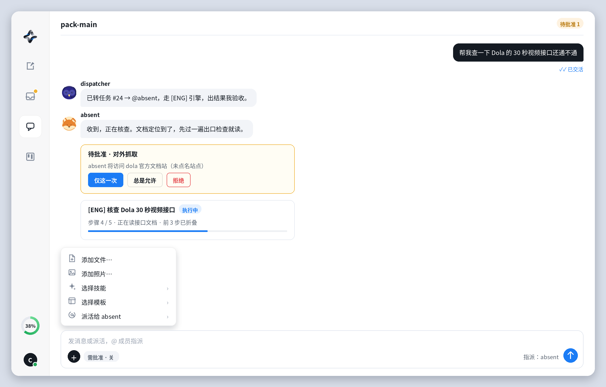
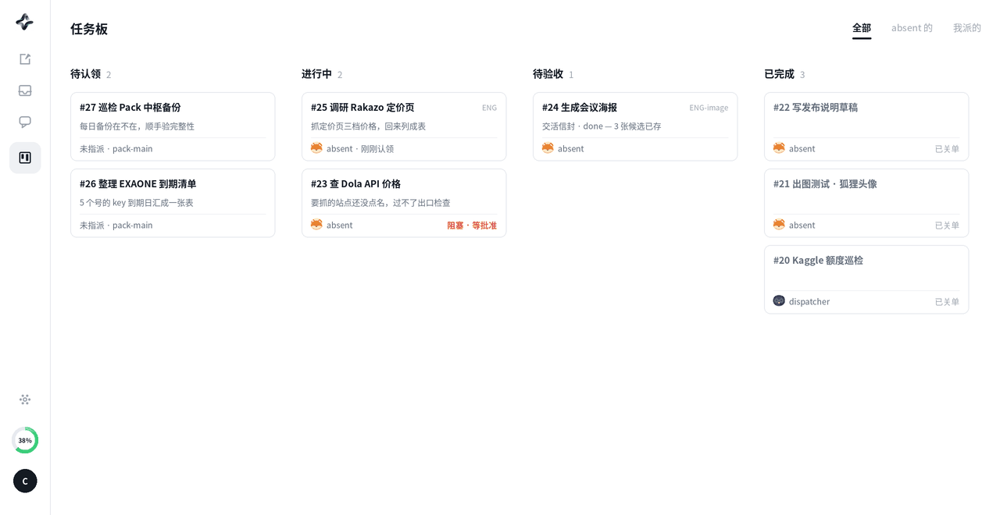
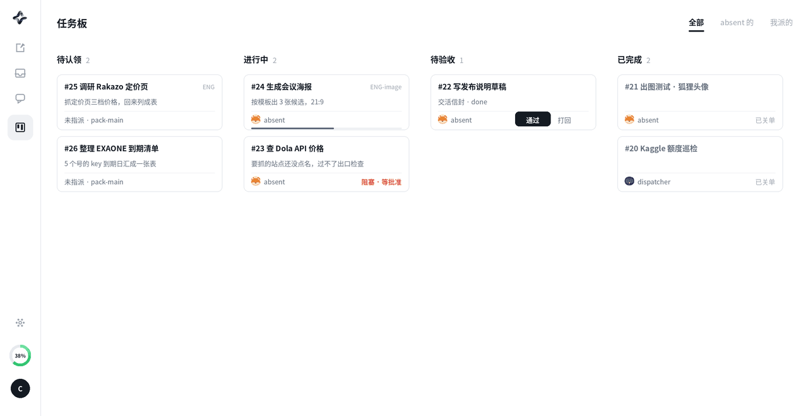

# ui-lab

chou 的 UI 设计参考库：专门存储 UI 设计想法与拆解，供后续项目调用。

- 每条设计一个条目，放在 `entries/`，统一格式：效果图、一句话结论、拆解数值、来源、状态。
- 展示面是 Muse 空间「UI 设计参考库」：画廊首页（图墙）+ 点开能试的仿真。
  空间是本仓的镜子，仓库更新后重渲染，两边不脱节。
- 结构与规矩见 `PLAN.md`；完整分类清单见 `TAXONOMY.md`（10 段 + 横切层，审计 v2 无遗漏版）。
- 给其他 AI 调用本库的方法见 `AI-USAGE.md`：含可直接粘贴的提示词、条目固定字段与验收清单。
- 状态口径：想法 → 待试 → 已采纳 → 已落地。
- 图片素材存本仓 `assets/`，条目以相对路径引用（见各条目「效果图」）。

## 效果图

## 条目索引

| # | 条目 | 分类 | 来源 | 状态 |
|---|------|------|------|------|
| 01 | [三栏布局骨架](entries/01-three-column-layout.md) | 布局骨架 | Pachat + Pack | 已采纳 |
| 02 | [悬浮胶囊顶栏](entries/02-floating-capsule-topbar.md) | 布局骨架 | Pachat | 已采纳 |
| 03 | [消息气泡](entries/03-message-bubbles.md) | 组件 | Pack 定稿 §3 | 已落地 |
| 04 | [任务板](entries/04-task-board.md) | 组件 | Pack 定稿 §5 | 已落地 |
| 05 | [批准卡](entries/05-approval-card.md) | 组件 | Pack 定稿 §3/§12.2 | 已落地 |
| 06 | [Pachat 完整案例](entries/06-case-pachat.md) | 完整案例 | Pachat | 已采纳 |
